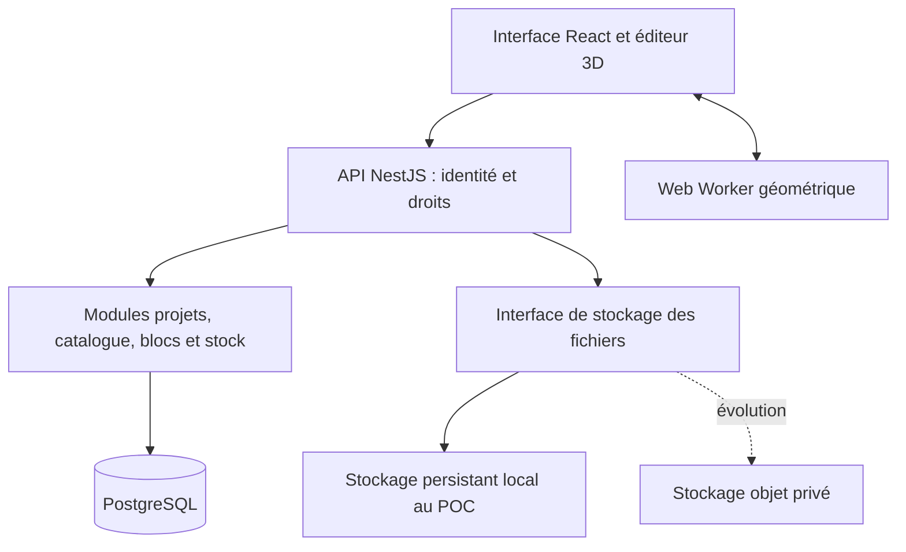

# Architecture — phase 1 et réalisation du POC

## Statut

La direction de cette architecture est acceptée pour réaliser le POC. La dernière consigne du porteur du projet impose simplicité d'hébergement, technologies courantes et couches remplaçables. Le choix d'un fournisseur d'hébergement et l'intégration du paiement restent futurs. Les propositions ci-dessous décrivent aussi la cible V1 ; l'état réellement implémenté est distingué dans [l'avancement](progress.md).

Adaptations techniques du premier lot : requêtes PostgreSQL via `pg` derrière le port `ClimbedRepository`, migrations SQL versionnées et vérifiées par empreinte, plutôt que Prisma ; hachage scrypt natif Node pour les comptes locaux plutôt qu'Argon2id ; styles CSS propres sans framework de styles ; commandes locales dans editor-core et absence de bibliothèque de requêtes supplémentaire tant que le besoin ne le justifie pas. Ces choix réduisent les dépendances initiales sans modifier le contrat REST ni le modèle métier. Les règles pures du domaine restent distinctes des composants React et du SQL.

## Choix directeur : monolithe modulaire

Une application web, une API métier modulaire et une base PostgreSQL. Ce découpage facilite les transactions entre installation et stock, les tests et la maintenance d’un premier produit. Des microservices introduiraient des déploiements et transactions distribuées sans besoin établi pour le POC.



Le rendu ne constitue ni la base de données ni le moteur de stock. Les commandes métier sont traitées par l’API, qui valide identité, périmètre, état, version et disponibilité.

## Technologies candidates

| Partie | Proposition | Raison et limite |
| --- | --- | --- |
| Runtime et workspace | Node.js 24, TypeScript, npm workspaces et lockfile racine | Outils disponibles ; installation reproductible par `npm ci` après création et vérification du lockfile. |
| Interface | React 19, Vite, Tailwind CSS | UI d’administration et panneaux d’édition ; choix précis de styles après architecture. |
| Rendu | Three.js, React Three Fiber 9, Drei 10 | Scène WebGL, caméras et outils ; ne remplace pas la géométrie métier. |
| État éditeur | Zustand pour l’état local ; TanStack Query pour les données serveur | Limiter les mises à jour React pendant une manipulation ; éviter deux autorités sur les mêmes données. |
| Géométrie | Module TypeScript indépendant, triangulation/extrusion de contours plans | Suffisant pour les pans et découpes traversantes ; pas de CSG général ajouté par défaut. |
| API | NestJS, REST JSON, OpenAPI | Modules et validation explicites ; l’API n’expose pas directement les tables. |
| Persistance | PostgreSQL 17 et Prisma 7.10.1, client de même version | Version PostgreSQL conservatrice proposée ; SQL contrôlé pour les contraintes et verrous que l’ORM ne représente pas. |
| Tests | Vitest, tests backend sur PostgreSQL réel, Playwright | Géométrie, concurrence et vrais parcours navigateur. |
| Exécution locale | Docker Compose pour PostgreSQL ; web/API Node en développement | Windows 11 visé avec Docker Desktop/WSL2 ; à vérifier sur un poste réel. |

Les versions observées et contraintes de compatibilité figurent dans [la recherche](research.md). Les versions exactes et images seront gelées après une installation et un build vérifiés ; aucune compatibilité complète n’est revendiquée sur la seule base des métadonnées npm.

## Organisation proposée du dépôt

Arborescence future ; ces dossiers applicatifs ne sont pas créés pendant la phase d’architecture.

```text
apps/
  web/                   interface et intégration du rendu
  api/                   API et modules métier
packages/
  contracts/             DTO, schémas de scène et versions de formats
  geometry/              paramètres, transformations et génération de maillages
  editor-core/           commandes, sélection, historique local, état du projet
docs/                    décisions, critères et documentation
infra/                   Compose et configuration locale non secrète
```

Les packages partagés ne contiennent pas de client Prisma ni de logique d’autorisation serveur. Le navigateur ne reçoit pas de secrets. Les contrats partagés n’empêchent jamais la validation des requêtes côté serveur.

## Modules métier

| Module | Responsabilités |
| --- | --- |
| Identité et accès | Comptes, invitations, sessions, adhésions client/salle, rôles et révocation. |
| Plateforme | Création et suspension de clients, affectation de leur premier administrateur. |
| Organisation et salles | Client, salles, zones et affectation des équipes. |
| Catalogue | Modèles réutilisables et versions de géométrie, variantes physiques et modèles d’assemblage. |
| Projets et scènes | Brouillons, révisions, pans, placements et état installé distinct. |
| Blocs | Parcours, départs, arrivée, cotation et statut ; plusieurs blocs peuvent partager un placement. |
| Stock et installation | Exemplaires, réservations, retraits, installation, retour et annulation. |
| Audit | Événements métier attribués à un acteur ; pas de journal de secrets ou de données de session. |
| Fichiers | Métadonnées et accès aux assets ; ingestion de modèles 3D seulement en V2. |

Pas de module de paiement, de réseau social ni de scan dans le POC. Le futur espace grimpeur consommera des données explicitement publiées, avec ses propres permissions. Il ne réutilisera pas les droits internes des ouvreurs.

## Isolation : client et salle

Proposition : une application et une base communes, avec séparation logique obligatoire. Un espace par salle ne signifie pas un serveur distinct. Cette solution réduit les coûts d’un pilote et permet le catalogue commun d’un client.

Un déploiement ou une base par client reste une alternative si un futur contrat exige une isolation d’exploitation ; il ajoute coûts, migrations et gestion de flotte. La migration vers cette alternative ne sera pas présentée comme gratuite ou automatique.

Règles obligatoires de la proposition :

1. Identité authentifiée établie par le serveur. Un identifiant de client reçu dans une requête n’accorde aucun droit.
2. Catalogue filtré par client ; scènes, stock et installations filtrés par client et salle.
3. Clés étrangères composées avec le client et, pour les relations physiques concernées, la salle. Elles empêchent les liaisons incohérentes entre périmètres.
4. Toutes les lectures, modifications, recherches, exports et accès fichiers utilisent le même contrôle d’autorisation. Un UUID difficile à deviner n’est pas une protection.
5. L’admin client accède à toutes ses salles ; responsable et ouvreur accèdent seulement à leurs salles autorisées.
6. L’ouvreuse ou l’ouvreur peut concevoir et agir sur ses opérations de matériel dans sa salle, sans administrer les rôles ni le stock initial. Les droits précis de correction de stock et d’annulation pour un collègue restent à valider.
7. L’accès technique du superadmin aux données métier passe par une action de support explicite et auditée. Cette politique est proposée, pas déjà validée comme droit automatique d’usurpation.

La RLS PostgreSQL peut renforcer ce dispositif avant production. Elle n’est pas considérée comme active ni acquise : elle nécessite des politiques testées, un contexte transactionnel fiable et des comptes séparés des rôles de migration. Son absence au POC devra être compensée par des chemins d’accès centralisés et des tests négatifs systématiques ; elle reste un point de revue avant ouverture commerciale.

Matrice d'actions proposée pour le POC, à valider avec cette architecture :

| Action | Superadmin | Admin client | Responsable salle | Ouvreur |
| --- | --- | --- | --- | --- |
| Créer/suspendre un client | Oui | Non | Non | Non |
| Gérer salles et responsables | Support explicite | Toutes ses salles | Non | Non |
| Affecter des ouvreurs | Support explicite | Toutes ses salles | Sa salle | Non |
| Concevoir et gérer les blocs | Support explicite | Toutes ses salles | Sa salle | Salles autorisées |
| Réserver et confirmer ses opérations | Support explicite | Toutes ses salles | Sa salle | Salles autorisées |
| Résoudre l'opération d'un collègue | Support explicite | Toutes ses salles | Sa salle, action tracée | Non |
| Entrer/corriger l'inventaire | Support explicite | Toutes ses salles | Sa salle, action tracée | Non |

Les corrections ne doivent pas effacer une occupation active : anomalie et résolution explicites. Les comptes de support ne constituent pas une route publique contournant les filtres métier. Toute extension de cette matrice doit être testée et documentée.

## Authentification proposée

Pour le premier produit web, sessions opaques révocables conservées côté serveur, cookie `HttpOnly`, `Secure` en HTTPS et `SameSite` approprié. Identifiants de session stockés sous forme de hash, expiration et rotation, protection CSRF des mutations et limitation des tentatives de connexion.

Un seul origin en production, avec l’API sous `/api`, simplifie cookies et CORS. En développement, le proxy Vite peut fournir ce même routage. Le flux local HTTP et le cookie de production doivent être configurés distinctement et testés, sans désactiver les protections en production.

Comptes créés ou invités par les administrateurs autorisés ; pas d’inscription publique. Mot de passe hashé avec Argon2id via une bibliothèque maintenue ; réinitialisation par jeton à usage unique et expiration. L’email est un besoin du produit exploité : en POC local, les invitations peuvent être remises manuellement par un administrateur ; aucun mot de passe partagé, fournisseur email ou secret n’est inventé. L’envoi réel et son fournisseur devront être configurés avant un pilote qui en dépend. MFA du superadmin à prévoir avant exposition commerciale.

## Contrats et concurrence

REST versionné sous `/api/v1`. Les opérations importantes sont des commandes métier : sauvegarder une révision, réserver, confirmer le retrait, confirmer l’installation, demander un démontage, confirmer le retour. Une API générique qui mettrait directement un champ `available=true` est exclue.

Chaque sauvegarde et changement d’installation transmet une version attendue. En cas de désaccord : conflit explicite et rechargement/comparaison proposés ; pas d’écrasement silencieux. Les commandes de réservation et retour acceptent une clé d’idempotence, scopée par client, acteur et opération, liée à une empreinte du contenu.

Le noyau de validation géométrique est utilisable sans navigateur et sera réexécuté côté serveur sur les entrées persistées. Les résultats du Web Worker client ne sont pas considérés comme fiables. Limites de taille des documents, nombre de sommets et complexité des formes seront fixées avec les premiers benchmarks pour borner le coût des requêtes.

Le check-in réserve atomiquement les ajouts d’une révision cible ; les éléments conservés restent affectés. Les suppressions projetées ne rendent aucune pièce disponible avant retour physique. Les règles détaillées, verrous et contraintes sont décrits dans [le modèle de données](database.md).

Une installation n’est pas automatiquement simultanée dans le monde réel. L’API conserve les confirmations déjà effectuées ; une annulation tardive passe par des actions compensatrices, jamais par l’effacement du journal.

## Sauvegarde, histoire et restauration

- Commandes d’édition réversibles et historique local pour annuler/rétablir dans l’éditeur.
- Brouillons persistants avec sauvegarde explicite et autosauvegarde contrôlée, état visible et version attendue.
- Révisions de scène immuables aux points de sauvegarde importants et au check-in.
- Audit des opérations physiques et des changements sensibles.

Restaurer un ancien projet crée une nouvelle révision de conception. Cette action ne réécrit pas le stock ni les installations passées. Une nouvelle mise en place exige un nouveau calcul de différences et une réservation valide.

Les changements de format ont un numéro et des migrations explicites ; une ancienne définition reste conservée jusqu’à migration vérifiée. Les maillages de rendu sont reconstruisibles, pas l’unique sauvegarde du projet.

## Préparer les modèles scannés et modélisés de V2

Le domaine manipulera un modèle et une version de géométrie, indépendamment de la provenance : définition paramétrique V1 ou asset de maillage V2. Les placements figent cette version. Inventaire, réservations et blocs ne dépendront pas de la façon dont le maillage a été créé.

Le candidat de format canonique est **glTF 2.0 / GLB**. OBJ, STL ou les formats de scanners ne sont pas promis en import direct : leur conversion, leurs unités et les droits d’utilisation devront être examinés en V2.

Un asset scanné doit être normalisé : échelle métrique, orientation, origine, contact au support, géométrie de placement et éventuelles fixations. Un beau rendu ne garantit pas ces informations. Une nouvelle version ne remplacera jamais silencieusement la géométrie utilisée par les installations existantes. Voir [le contrat 3D](editor-3d.md).

## Exploitation et sauvegardes

POC : PostgreSQL dans un volume persistant, configuration locale ignorée par Git et fichiers éventuels hors des sources. L’adaptateur de fichiers permettra ensuite un stockage objet privé. Les références et hashes sont en base ; les données binaires volumineuses restent hors JSON de scène et hors Git.

Avant un pilote : HTTPS, secrets injectés, migrations contrôlées, journaux structurés avec identifiant de requête, suivi des erreurs et contrôles de santé. La santé de l’API doit tester sa dépendance à la base ; elle ne remplace pas un scénario fonctionnel.

Prévoir sauvegarde PostgreSQL et copie cohérente des assets, avec manifeste de leurs identifiants/hashes, rétention et accès restreint. Tester une restauration dans une base et un répertoire distincts. RPO, RTO, région d’hébergement, hébergeur et rétention restent à définir avant exploitation réelle ; aucun engagement n’est inventé pendant le POC.

Les processus ne sont pas supposés survivre à un redémarrage ou à une restauration de l’environnement cloud. Les commandes effectives d’installation et de démarrage seront documentées et testées lorsque les services existeront.

## Ordre d’implémentation proposé après validation

1. Installer une base reproductible, définir les contrats de scène et le noyau géométrique ; prouver rapidement un pan, une prise et la sauvegarde.
2. Ajouter le minimum d’authentification, clients/salles et contrôles d’accès avant tout partage de données entre utilisateurs.
3. Démontrer pans assemblés, volumes, placement sur supports, découpes simples et sauvegarde/rechargement avec tests navigateur.
4. Relier les variantes aux exemplaires ; implémenter réservation atomique, confirmation d’installation, modifications et retours.
5. Démontrer les blocs, l’historique, les conflits concurrents et la scène de performance sur laptop.

Les étapes sont intégrées en petits lots démontrables. Cet ordre proposé adapte le plan initial pour éviter de développer une grande quantité d’objets sans isolation, tout en donnant une preuve 3D très tôt. Chaque phase importante garde sa validation utilisateur.
